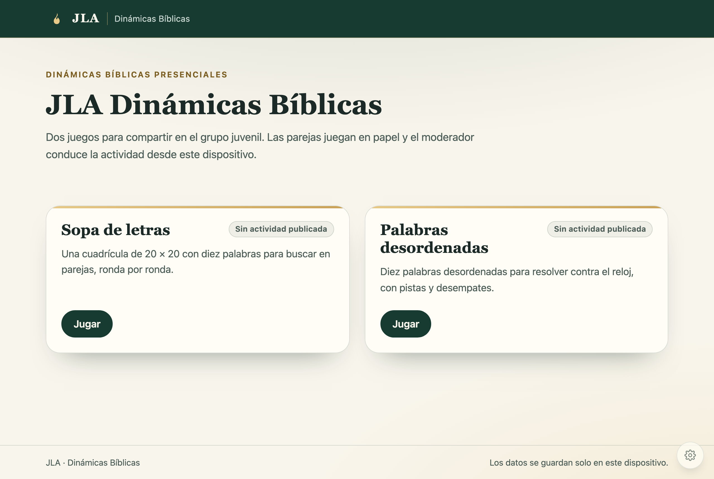
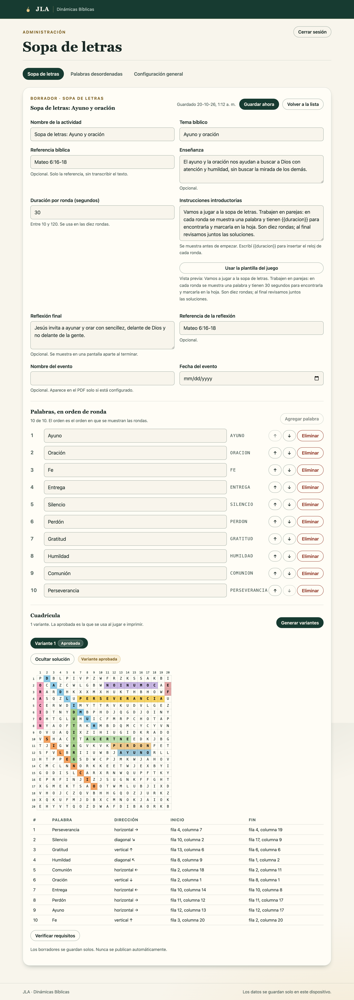
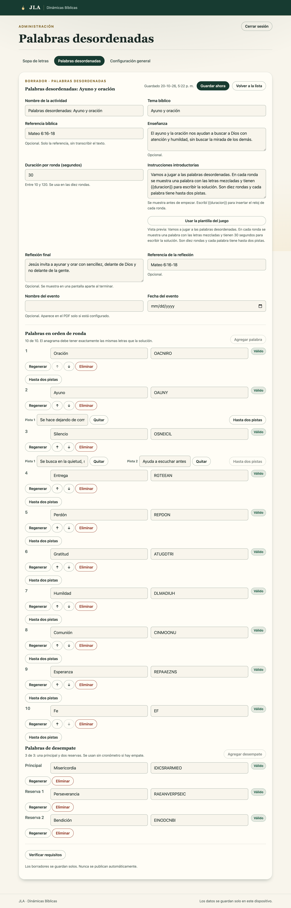

# JLA Dinámicas Bíblicas

Aplicación web estática para las dinámicas bíblicas presenciales del grupo juvenil JLA. Dos juegos —**Sopa de letras** y **Palabras desordenadas**— con administración local, ensayos, proyección, impresión y respaldos.

Sin backend, sin cuentas, sin servicios de pago y sin dependencias en tiempo de ejecución. Toda la información vive en el navegador del dispositivo.

**Publicada en:** <https://d-yanez.github.io/jla-dinamicas-biblicas/>

> **Estado: fases 1 a 4 de 10 terminadas y verificadas.** Portada, panel con PIN, modelo de actividades con borradores, motor de sopa de letras 20×20 y motor de palabras desordenadas con anagramas validados, pistas y desempates. Faltan los juegos en pantalla, los temporizadores, la impresión, la biblioteca y los respaldos (ver [Roadmap](#roadmap)).



---

## Ejecutar localmente

El proyecto usa módulos ES nativos, así que **no se abre con `file://`**: necesita un servidor HTTP, por la misma política de origen que aplica a cualquier módulo.

```bash
# desde la raíz del proyecto
python3 -m http.server 8080
```

Abrí <http://localhost:8080/>. Cualquier servidor estático sirve (`npx serve`, `php -S localhost:8080`, Live Server de VS Code). No hay paso de compilación ni instalación de dependencias.

## Publicar en GitHub Pages

1. Subí el contenido del repositorio tal cual (no hace falta compilar nada).
2. En GitHub: **Settings → Pages**.
3. En *Source* elegí **Deploy from a branch**.
4. Rama `main` y carpeta `/ (root)`. Guardá.
5. Esperá la publicación: queda en `https://usuario.github.io/nombre-repositorio/`.

Funciona igual publicado en una subruta porque:

- todas las rutas a archivos son **relativas** (`./src/...`, `./assets/...`), nunca absolutas;
- la navegación usa **hash** (`#/`, `#/juego/sopa`, `#/admin/config`), y GitHub Pages no reescribe rutas desconocidas—un router por *path* rompería la recarga y los enlaces profundos en subruta;
- no hay ninguna URL de CDN: todo se sirve desde el mismo repositorio.

## Verificar antes de usar

```bash
# 157 pruebas unitarias de la lógica pura (Node 22+, sin dependencias)
node --test tests/*.test.mjs

# 45 verificaciones funcionales en un navegador real (Playwright, opcional)
node tests/browser-smoke.mjs
```

El segundo comando es una herramienta de desarrollo: levanta su propio servidor estático, recorre el flujo completo de fase 1 y falla si la consola del navegador registra un error. Requiere Playwright instalado (`npm i -g playwright && playwright install chromium`); **la aplicación publicada no lo usa**.

Para validar el sitio ya publicado, apuntalo a la URL real:

```bash
JLA_BASE_URL=https://d-yanez.github.io/jla-dinamicas-biblicas/ node tests/browser-smoke.mjs
```

Qué cubre la verificación de navegador: portada y tarjetas, `Jugar` sin actividad publicada, creación y confirmación del PIN, descarga y formato del archivo de recuperación, preferencias de tamaño y contraste, persistencia tras recarga, PIN incorrecto, cierre de sesión, importación del archivo de recuperación con PIN nuevo, rechazo de un archivo de otro dispositivo, ausencia de desborde horizontal en móvil, en fase 2: el ejemplo de sopa como borrador, el editor con diez palabras y 400 celdas, la solución coloreada con su tabla de coordenadas, la verificación de requisitos, el descarte de variantes al cambiar una palabra, la generación de tres variantes con aprobación de una, y la persistencia del borrador tras recargar; y en fase 3: el ejemplo de palabras desordenadas como borrador con tres desempates, diez soluciones y anagramas válidos, el rechazo de un anagrama con letras de más, la regeneración, la verificación de requisitos y la persistencia de las pistas tras recargar.

## Motor de sopa de letras (fase 2)



- **20×20 exacto**: la cuadrícula guarda **400 caracteres A–Z**, una letra por celda. Las palabras conservan su forma con acentos para mostrarse (`ORACIÓN`) y una forma normalizada para ubicarse (`ORACION`), de modo que una tilde nunca rompa el conteo de 400.
- **Diez ubicaciones verificadas**: cada palabra guarda inicio, fin y una de las ocho direcciones (horizontales, verticales y las cuatro diagonales, en ambos sentidos). La app **vuelve a leer** cada camino sobre la cuadrícula guardada antes de aceptarlo.
- **Variantes previsualizables**: se generan tres cuadrículas por semilla, cada una se puede ver resuelta con colores y con la tabla de coordenadas del moderador, y solo una queda **aprobada**.
- **La cuadrícula nunca se regenera**: se guarda como dato con su semilla. Jugar, imprimir, recargar o restaurar no pueden cambiarla. Si las palabras cambian, las variantes se descartan y la app lo avisa.
- **Requisitos antes de publicar**: nombre, tema, instrucciones, duración entre 10 y 120 segundos, diez palabras válidas y sin repetir, y una variante aprobada que coincida con esas palabras. Los errores se listan uno por uno. Publicar llega en la fase 7.

## El PIN: qué protege y qué no

El PIN de cuatro dígitos evita que alguien que toma el dispositivo entre al panel por accidente. **No es seguridad criptográfica**: cualquiera con acceso al navegador puede leer IndexedDB con las herramientas de desarrollo. Aun así el PIN nunca se guarda en claro: se almacena con PBKDF2-SHA256 (210 000 iteraciones y sal propia por registro).

- Se crea al entrar por primera vez a **Administrar** y se pide cada vez que se vuelve desde la portada. Dentro del panel no se vuelve a pedir.
- Al crearlo se ofrece un **archivo de recuperación**. Es propio de cada dispositivo y sirve para definir un PIN nuevo sin tocar las actividades.
- El PIN y su archivo de recuperación **quedan fuera de todos los respaldos JSON**, por diseño.
- Si se pierden el PIN y el archivo: las actividades siguen guardadas en el navegador, pero el panel queda inaccesible. Es la razón por la que el panel insiste en descargar el archivo.

## Motor de palabras desordenadas (fase 3)



- **Diez palabras** con solución editable, anagrama editable o regenerable y **hasta dos pistas opcionales** por palabra. El orden de la lista es el orden de las rondas.
- **Multiconjunto de letras**: solución y anagrama deben tener exactamente las mismas letras, ni una más ni una menos, con la misma normalización que la sopa (mayúsculas, sin acentos, `A–Z`). El estado de cada fila se actualiza mientras se escribe: «Válido» o el motivo exacto.
- **El anagrama no puede ser igual a la solución**. La generación prefiere mover al menos dos letras y avisa cuando una palabra no admite un anagrama distinto, en vez de entregar uno trivial.
- **Tres palabras de desempate** (Principal, Reserva 1 y Reserva 2) con respuesta y anagrama válidos: requisito para publicar, igual que las diez palabras.
- **El anagrama se guarda y se muestra sin acentos**: mezclar `ORACIÓN` con sus tildes filtraría dónde va el acento.

## Configuración inicial (opcional)

Si querés que **un navegador sin datos** —la computadora de la iglesia, un perfil nuevo— abra la app con tus actividades ya cargadas, y sin pendrive:

1. Configurá los dos juegos acá y publicá lo que querés que quede listo.
2. **Administración → Configuración general → Datos y respaldo → Exportar respaldo**.
3. Guardá ese archivo como `assets/configuracion-inicial.json` y commiteá el cambio.
4. Verificá antes de publicar:

```bash
node scripts/validate-seed.mjs
```

Reglas del mecanismo:

- Se aplica **solo a un navegador sin datos**. Nunca toca un equipo que ya tiene actividades.
- Una actividad **publicada** en el archivo queda publicada (una por juego), así la iglesia abre y juega sin tocar nada. El resto entra como borrador.
- Si el archivo no existe, la app usa los ejemplos de demostración.
- El archivo **no contiene el PIN**: cada dispositivo tiene el suyo.

El script solo valida: una línea de comandos no puede escribir el IndexedDB del navegador, así que la importación real ocurre en la app.

## Los datos

Todo se guarda en **IndexedDB** (`jla-dinamicas`), con esquema versionado y migraciones incrementales.

Las **preferencias de interfaz** (tamaño y contraste) son la excepción deliberada: van a `localStorage`, porque su escritura es síncrona. Con IndexedDB, cambiar el contraste y recargar enseguida perdía el cambio sin ningún error; con `localStorage`, el valor queda escrito antes de que la página pueda irse. Es el uso que la especificación permite para preferencias pequeñas.

> Si se borran los datos del navegador, se usa una ventana privada o se cambia de dispositivo, la información se pierde. El respaldo manual en JSON llega en la fase 7.

## Estructura

```
index.html                      app shell: meta, estilos, punto de entrada
assets/favicon.svg              llama JLA
src/
  main.js                       entrada; arranca la app
  app.js                        estado, ruteo, acciones y toda la escritura de datos
  core/                         lógica pura, sin DOM (probada por tests)
    db.js                       IndexedDB + migraciones versionadas
    pin.js                      PBKDF2: crear y verificar PIN
    recovery.js                 archivo de recuperación: construir, parsear, comparar
    prefs.js                    tamaño/contraste: normalizar, guardar y aplicar
    router.js                   rutas por hash, etiquetas, bloqueo al salir de admin
    admin-gate.js               máquina de estados de acceso al panel
    activities.js               repositorio de actividades y ejemplo inicial
    activity-model.js           modelo común, validación estricta y firma de contenido
    letters.js                  alfabeto A-Z y normalización de palabras
    random.js                   PRNG determinista por semilla
    sopa.js                     motor 20×20: ubicar, verificar, variantes
    rounds.js                   motor de rondas: etapas, reloj, revisión, extra de 60 s
    audio-plan.js               qué suena ante cada evento y cuánta tensión
    anagram.js                  multiconjunto de letras y generación de anagramas
    instructions.js             plantillas de instrucciones con la duración interpolada
    ids.js                      identificadores
  ui/                           DOM puro; sin acceso a almacenamiento
    dom.js  icons.js  fields.js  download.js  common.js  format.js
    home.js  game.js  gate.js  admin.js  security.js
    draft-session.js            autoguardado, lista, apertura y duplicado (compartido)
    activity-editor.js          campos comunes y verificación de requisitos (compartido)
    sopa-admin.js               sección de sopa: palabras y variantes
    palabras-admin.js           sección de palabras: solución, anagrama, pistas y desempates
    play.js                     pantalla de juego: rondas, reloj, revisión y cierre
    audio.js                    sonidos sintetizados con WebAudio
    grid.js                     cuadrícula 20×20 con solución coloreada
  styles/
    tokens.css                  paleta JLA, tamaño, alto contraste
    base.css                    reset, tipografía, accesibilidad
    components.css              componentes visuales
tests/                          pruebas unitarias + smoke de navegador
odd/tasks/                      registro de trabajo por fase (ODD)
docs/capturas/                  capturas usadas en este README
```

### Decisiones técnicas

| Decisión | Motivo |
|---|---|
| Sin bundler ni build | Un repositorio de archivos estáticos es lo que GitHub Pages sirve mejor; cero mantenimiento de toolchain |
| Módulos ES nativos | Aislamiento real entre capas: `core/` no toca el DOM, `ui/` no toca el almacenamiento |
| Router por hash | Sobrevive a la subruta, a la recarga y al modo offline sin configuración del servidor |
| IndexedDB con migraciones | Datos estructurados, versión explícita y upgrade en sitio sin perder actividades |
| PBKDF2 en vez de PIN en claro | Aunque el PIN no sea una frontera de seguridad, una base filtrada no debe revelarlo |
| Preferencias en `localStorage`, datos en IndexedDB | Una preferencia debe sobrevivir a una recarga inmediata; IndexedDB escribe de forma asíncrona y la perdería en silencio |
| Desbloqueo solo en memoria | Recargar vuelve a pedir el PIN: el comportamiento más seguro en un notebook compartido |
| Nodes construidos por datos, nunca HTML | No hay superficie de inyección aunque un nombre de actividad traiga markup |
| Playwright solo como herramienta de desarrollo | La app publicada no tiene dependencias; el navegador se usa para verificar, no para funcionar |

## Accesibilidad y pantalla

- Tamaño de proyección **Grande** por defecto y **Normal** para pantallas chicas; escala toda la interfaz.
- **Alto contraste** independiente: no reemplaza el estilo JLA, lo refuerza.
- Foco visible siempre, enlace «Saltar al contenido», `aria-current` en la navegación del panel, errores con `role="alert"`, diálogos nativos con `Esc` y foco atrapado.
- Respeto de `prefers-reduced-motion`.

## Roadmap

| Fase | Entregable | Estado |
|---|---|---|
| 1 | Estructura, portada, responsive, persistencia y acceso PIN | ✅ terminada |
| 2 | Modelo de actividades, borradores y motor de sopa de letras 20×20 | ✅ terminada |
| 3 | Motor de palabras desordenadas (anagramas, pistas, desempates) | ✅ terminada |
| 4 | Presentación, temporizadores, sonido, atajos, extra de 60 s | ✅ terminada |
| 5 | Ensayos, guardado y recuperación de sesión | pendiente |
| 6 | Impresión y PDF carta (participantes y moderador) | pendiente |
| 7 | Biblioteca, publicación, papelera y respaldos JSON | pendiente |
| 8 | Proyección de dos ventanas sincronizadas | pendiente |
| 9 | Offline, actualización consentida, accesibilidad final | pendiente |
| 10 | QA completo y despliegue | pendiente |

La especificación completa está en `JLA_Dinamicas_Biblicas_Roadmap_y_Prompt_Maestro.md`, que es la fuente de verdad del proyecto.

## Limitaciones conocidas de esta versión

- La sesión no sobrevive a una recarga: guardar y recuperar la partida interrumpida es la fase 5, junto con el modo ensayo.
- La pantalla de juego de palabras desordenadas, sus temporizadores y los desempates en vivo llegan en la fase 4; el motor y la validación ya están.
- La publicación existe en su forma mínima (una actividad por juego). Biblioteca con búsqueda, filtros, papelera y respaldo JSON: fase 7.
- No hay impresión ni PDF: fase 6.
- No hay service worker: la aplicación necesita conexión en la primera carga y en cada recarga mientras no exista la fase 9.
- El PIN no resiste a alguien con acceso al navegador (ver arriba).
